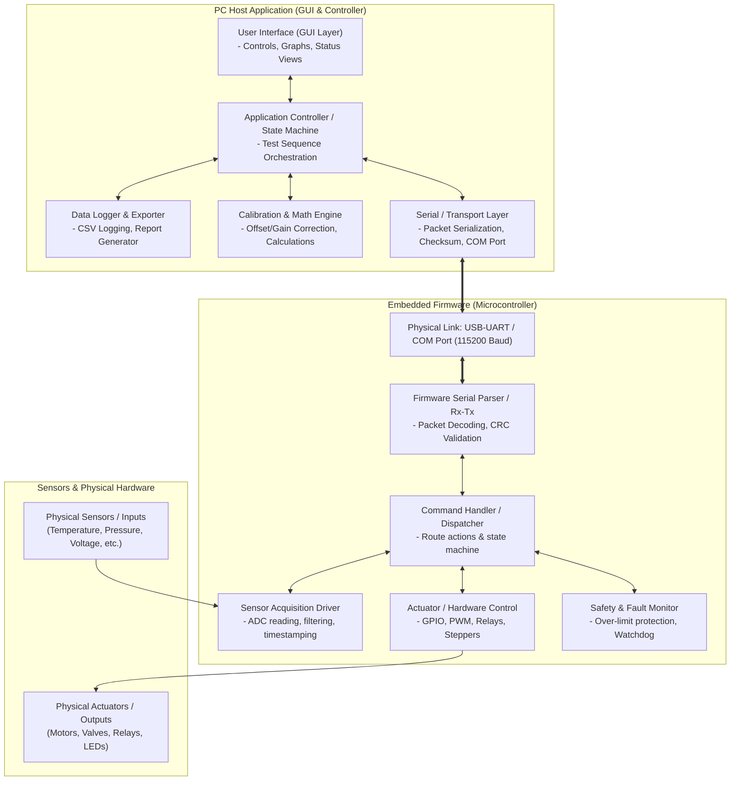

# 02 - System Architecture & Module Descriptions

This document outlines the high-level architecture of the software system, detailing how components interact across the hardware-software boundary, and listing the software modules developed by team members.

---

## 1. High-Level Architecture Diagram

---

## 2. Module Breakdown & Team Responsibilities

Ask each team member to provide a 2–3 sentence summary of their assigned module and fill out the table below:

| Module Name | Layer | Owner / Author | Description & Responsibilities |
| :--- | :--- | :--- | :--- |
| **GUI & Visualization** | PC Application | *[Team Member Name]* | Implements the graphical layout, real-time telemetry plots, user control panels, and configuration forms. |
| **Serial Communication (PC)** | PC Application | *[Team Member Name]* | Handles auto-detection of USB COM ports, connection states, packet packing/unpacking, and timeouts. |
| **Test Sequence & Logic** | PC Application | *[Team Member Name]* | Orchestrates multi-step test sequences (start, hold, ramp, measure, stop) and automated test flows. |
| **Data Logging & Report** | PC Application | *[Team Member Name]* | Writes formatted timestamped CSV data files and calculates summary statistics (min, max, mean, pass/fail). |
| **Communication Protocol (FW)**| Firmware | *[Team Member Name]* | Receives byte streams from UART, validates checksum/CRC, extracts opcodes, and replies with ACK/NACK packets. |
| **Sensor Acquisition** | Firmware | *[Team Member Name]* | Reads analog/digital sensors (I2C/SPI/ADC), applies low-pass filtering, and converts raw bits to engineering units. |
| **Actuator & Hardware Control**| Firmware | *[Team Member Name]* | Controls PWM duty cycle, relay states, and motor speeds based on PC command dispatches. |
| **Safety & Watchdog** | Firmware | *[Team Member Name]* | Monitors emergency stop, temperature/current thresholds, and software watchdog to prevent hardware damage. |

---

## 3. Data Flow Overview

1. **User Action:** The user presses a button on the PC UI (e.g., `START TEST` or `SET CALIBRATION`).
2. **Command Packaging:** The PC Application Controller builds a standardized packet with an Opcode and parameters, computes a checksum, and sends it over Serial.
3. **Firmware Reception:** The Firmware Serial Parser reads bytes from the UART buffer, validates the checksum, and triggers the Command Dispatcher.
4. **Execution:** The Firmware reads sensors or triggers hardware outputs.
5. **Telemetry Stream / Response:** Firmware replies with an acknowledgment (ACK) or streaming data frame containing sensor readings.
6. **Display & Log:** PC GUI receives the response, updates the chart/status labels, checks limits, and appends the row to the active CSV log file.
